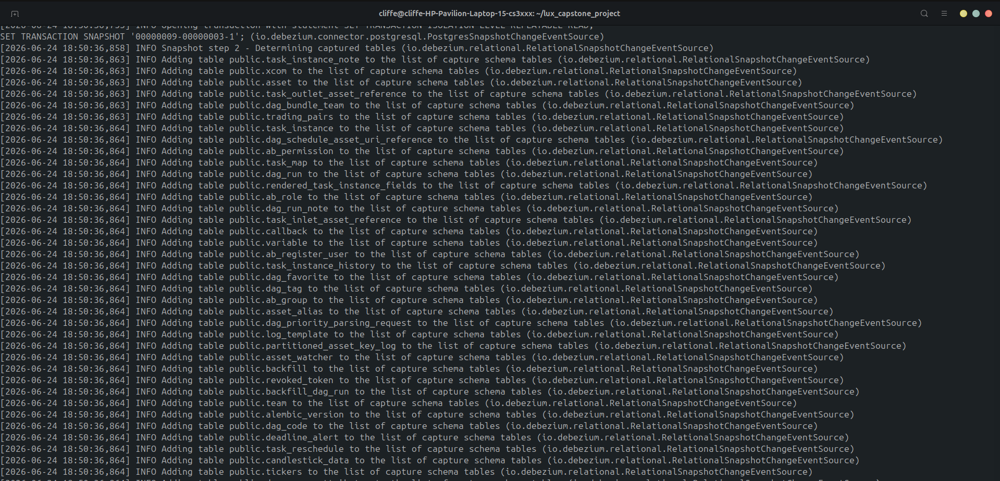
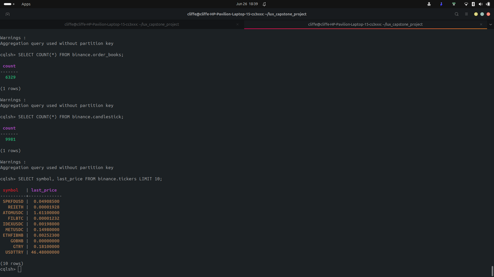
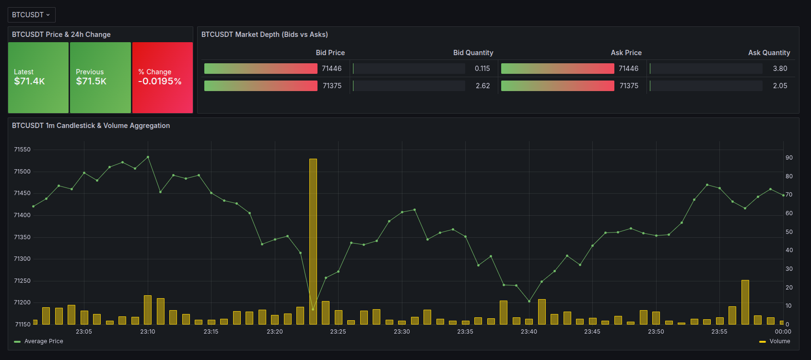
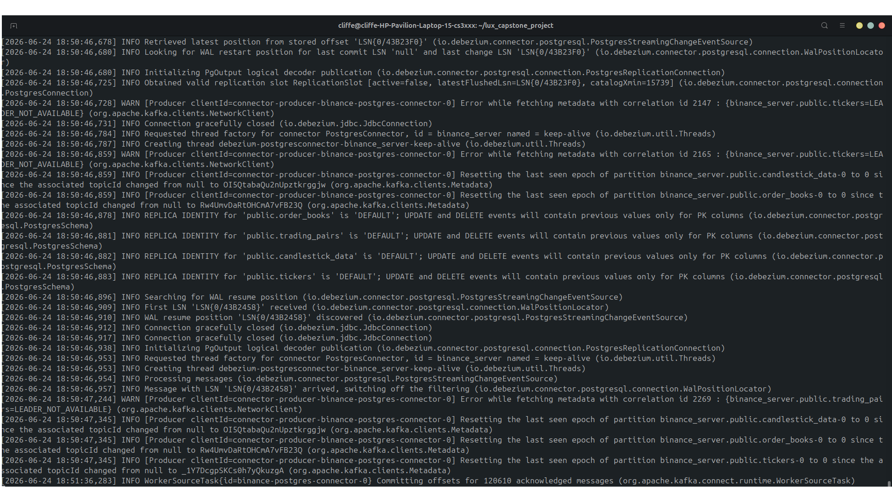

# Crypto Market Data Pipeline: Batch Ingestion to Micro-Batch Streaming


## Summary

This is a distributed pipeline designed to turn heavy batch extraction from the Binanace API into streaming analytics with 30 second micro-batches.

It extracts market depth (Order Books), historical (Candlesticks) and live prices (Tickers) for over 3,700 trading pairs, captures every new row with Change Data Capture (CDC), streams it through Kafka, processes it with Spark Structured Streaming and then serves it to a Grafana dashboard through a FastAPI layer.

The whole stack runs on a single laptop (12GB+ RAM recommended), which forced deliberate tuning of JVM heaps, Spark partitioning, and database writes. The processing layer is designed to move to Azure Databricks (see [Next Steps](#next-steps)).

## Project Structure
 
```text
.
├── app.py                  # FastAPI serving layer
├── dags/                   # Airflow DAGs (binance_batch_pipeline)
├── src/
│   ├── processing/         # spark_processor.py (Structured Streaming job)
│   └── utils/              # spark_utils.py, kafka_utils.py
├── docker/
│   ├── airflow/            # Airflow image
│   ├── debezium/           # Kafka Connect image + connector registration
│   ├── grafana/provisioning/
│   └── init/init.cql       # Cassandra keyspace and tables
├── docs/                   # screenshots
├── docker-compose.yml
├── env.example
└── LICENSE
```

## System Architecture

```
            Binance/Kraken API → Airflow ingestion → PostgreSQL staging → Kafka
                                                        ↓
            Dashboard/API ← Cassandra serving ← Spark streaming processing
```

## Data Flow 

1. **Extraction & Orchestration (Airflow & Pandas):** 
   Airflow DAGs trigger Python scripts that hit Binance REST endpoints. To manage API rate limits across 3,700+ assets, the payload is paginated, flattened, and safely loaded into a PostgreSQL landing zone in chunks.
2. **Change Data Capture (Debezium):** 
   Instead of querying the database for changes, Debezium monitors the PostgreSQL Write-Ahead Log (WAL). Any new market data is instantly captured and broadcasted as an event.



3. **Message Broker (Kafka):** 
   Kafka acts as a buffer by taking in CDC (change data capture) events and separating the heavy data collection from the analytics system.
4. **Stream Processing (PySpark):** 
   Apache Spark Structured Streaming consumes the Kafka topics in 30-second micro-batches. It deserializes Avro, casts schemas, flattens nested payloads, and writes the result to Cassandra. Candlesticks are already 1-minute aggregates from Binance, so they pass through without further windowing.
5. **Serving Layer (Cassandra & FastAPI):** 
   Processed metrics are written to Apache Cassandra, chosen for its high-write throughput. A decoupled FastAPI application acts as the serving layer, querying Cassandra and exposing RESTful endpoints (`/candlesticks`, `/order-books`, `/tickers`, `/trading_pairs`).



6. **Visualization (Grafana):** 
   A provisioned Grafana dashboard fetches data from the FastAPI layer, using binary transformations to calculate real-time percentage changes, offloading compute from the database.

### API endpoints
 
| Endpoint | Returns |
|---|---|
| `GET /tickers/{symbol}` | Latest price |
| `GET /candlesticks/{symbol}?limit=10` | Latest 1-minute candles: close price, volume and high–low spread |
| `GET /order-books/{symbol}?limit=5` | Recent best bid/ask snapshots (price and quantity) |
| `GET /trading-pairs?limit=100` | Active pairs with base and quote assets |
 
Interactive docs are served at `/docs`.
 
## Getting Started
 
### Prerequisites
* Docker & Docker Compose
* Python 3.12+ (managed via `uv` or `pip`)
* Minimum 8GB RAM (12GB+ highly recommended)
* **Environment Variables:** Copy the provided `env.example` file to `.env` and fill out the required credentials:
  ```bash
  cp env.example .env
  ```

### Step 1. Boot the stack
 
The `docker-compose.yml` utilizes native healthchecks to orchestrate the entire boot sequence properly. Start everything with a single command:
 
```bash
docker compose up -d
```
Wait a few minutes for ZooKeeper, Kafka, and Debezium to register their connectors, and for Airflow to run its initialization. Check progress with `docker compose ps`. Every service should show as running or healthy.

### 2. Trigger Pipeline Extraction
Navigate to the Airflow Web UI (`http://localhost:8080`), enable, and trigger the `binance_batch_pipeline` DAG. The DAG first polls Debezium's REST API (up to about 5 minutes) and fails with an error if the connector never reaches `RUNNING`. The Spark job waits about 8 minutes for the first CDC events to register their schemas and is restarted automatically (up to 10 times) if it exits; if it has used all its restarts, run `docker compose restart spark-submitter`. Follow chunked ingestion in the Airflow task logs.

### 3. Initialize the API Serving Layer
Install the API requirements and boot the ASGI server:
```bash
uv pip install fastapi uvicorn cassandra-driver
uv run python app.py
```

The API listens on <http://localhost:8000>

### 4. Monitor Live Data
Navigate to `http://localhost:3000`. Grafana will bypass manual setup via YAML provisioning and instantly render the live data flowing through the pipeline.



### Verify the pipeline works
 
```bash
# Debezium connector registered
curl -s http://localhost:8083/connectors
 
# CDC topics exist
docker exec kafka kafka-topics --bootstrap-server localhost:9092 --list
 
# Rows landing in Cassandra
docker exec cassandra cqlsh -e "SELECT COUNT(*) FROM binance.tickers;"
 
# API responds
curl -s http://localhost:8000/tickers/BTCUSDT
```

## Engineering Challenges and Solutions
 
### 1. JVM memory pressure on a single host
- **Problem:** Spark and Kafka JVMs claimed host RAM, causing swap thrashing and OOM freezes.
- **Fix:** Explicit caps on every JVM service: ZooKeeper 256MB heap, Kafka, Kafka Connect and Schema Registry 512MB each, Cassandra 1GB, Spark driver 1GB and executor 2GB. Kafka consumption is throttled to 2,000 offsets per 30s trigger (`maxOffsetsPerTrigger`: challenge 5 explains why it was lowered from 20,000), `spark.sql.shuffle.partitions` was cut from 200 to 4, and `minBatchesToRetain` was lowered to 2.
- **Result:** With these heap caps, ingestion runs without OOM failures. A `docker stats` snapshot taken during ingestion (at the earlier 20,000-offset setting) totals about 6.4GiB across all containers on a 16GB laptop (largest: Cassandra 1.3GiB, Spark worker 1.0GiB, Debezium 0.8GiB, Spark driver 0.8GiB, Kafka 0.6GiB).


 
### 2. PostgreSQL locking on bulk inserts
- **Problem:** Bulk-inserting the candlestick and nested order-book payloads in one go pushed PostgreSQL into recovery mode
- **Fix:** Switched to small, per-table insert chunks in Pandas (25 to 500 rows per statement), with the largest nested payloads in the smallest chunks to keep each statement and transaction manageable.

### 3. Startup race conditions
- **Problem:** Kafka entered exponential backoff when started before ZooKeeper had initialized its transaction logs, and the Airflow load job would fire before CDC was ready, causing data to bypass Kafka.
- **Fix:** Added a ZooKeeper healthcheck (`cub zk-ready`) that Kafka waits on in Docker Compose, and a `BashOperator` in Airflow that polls Debezium's REST API until the connector reports `RUNNING` before the batch load starts.

### 4. Nested Avro from Debezium
- **Problem:** Debezium emits nested, binary Avro envelopes. Spark's `from_avro` cannot read Confluent's wire format directly, because every message starts with a 5-byte header (magic byte plus schema ID).
- **Fix:** At startup, the job fetches each topic's schema from the Schema Registry (with retries), strips the 5-byte header, decodes with `from_avro`, and unwraps the Debezium envelope's `after` block into typed columns for aggregation.

### 5. Cassandra write timeouts on a single node
- **Problem:** Writing at full speed made the single Cassandra node (1GB heap) time out (`Cassandra timeout during SIMPLE write query at consistency LOCAL_QUORUM`), which terminated the Spark query.
- **Fix:** Throttled the Cassandra writer (1 concurrent write, 64 rows per batch, 1MB/s per core), lowered `maxOffsetsPerTrigger` from 20,000 to 2,000, and scoped the extract to actively trading USDT pairs with 100 candles each. `spark-submitter` has `restart: on-failure:10`, so a failed micro-batch resumes from its checkpoint, and because writes are upserts by primary key a replayed batch is harmless.
- **Result:** In one run a write timeout aborted a batch, the container restarted on its own, and the load finished from its checkpoint with all 51,800 candlesticks in Cassandra.


## Design Decisions
 
- **CDC between Airflow and Kafka:** Airflow writes only to PostgreSQL; Debezium tails the WAL (`pgoutput`) and publishes row-level events. Extraction code knows nothing about Kafka, new consumers can be added or replayed without hitting Binance API rate limits, and nothing polls the database.
- **Kafka as a buffer:** It isolates the bursty batch load from stream processing, and `maxOffsetsPerTrigger` bounds how fast Spark consumes, protecting the single-node host.
- **No windowing on candlesticks:** Binance already returns 1-minute candles, so a second 1-minute window added no information, and in append mode its watermark held results back until later data arrived. Candles now stream straight to Cassandra, which upserts by primary key.
- **Scoped extraction:** Order books and candles are fetched only for pairs with status `TRADING` and quote asset USDT (518 pairs), because halted pairs have no market and a single-node Cassandra cannot absorb the full symbol list. Tickers and trading-pair metadata still cover every symbol.
- **Idempotent loads:** Every landing table has a primary key (`symbol`, plus `open_time` or `lastUpdateId` where needed), and the loader upserts with `INSERT ... ON CONFLICT`. Re-running the DAG creates no duplicates, and rows whose values did not change generate no CDC events.
- **Avro + Schema Registry:** Events are compact and schema-enforced, and the Spark job fetches schemas dynamically over HTTP at startup instead of hard-coding brittle schema files.
- **Cassandra for serving:** Rows are keyed by symbol and ordered by time. High write throughput supports continuous upserts by primary key, and symbol-then-time ordering makes "latest N for a symbol" a single-partition read.
- **48-hour TTL on high-churn tables:** `candlestick`, `order_books`, and `tickers` rows expire 48 hours after being written (`spark.cassandra.output.ttl`), which keeps the local keyspace from growing without bound while leaving a buffer over the daily DAG schedule.

## Limitations
 
- Single-node deployment: no replication, so fault tolerance is limited to Spark checkpoints and Docker restarts.
- Micro-batch latency is bounded below by the 30-second trigger.
- Messages are decoded with the latest registered schema rather than the schema ID embedded in each message, so a breaking schema change would mis-decode older buffered messages.
- Throughput is capped at 2,000 events per 30s trigger (about 67 per second), so the 51,800-candle load needs at least 26 triggers (about 13 minutes) to drain.
- Each run fetches only the latest 100 one-minute candles per pair, so with a daily schedule most minutes between runs are never captured. An hourly schedule or paging by start time would close the gap.
- Serving data expires 48 hours after it is written (TTL), so two consecutive missed daily runs leave the dashboard empty.
- Airflow metadata shares the PostgreSQL instance that holds market data, which is fine locally but should be separated in production.
- Changing the nullability of a captured table (for example adding a primary key to an existing table) is incompatible with the Schema Registry's default BACKWARD compatibility and stops the Debezium task. Existing deployments must reset the Kafka topics and registry subjects, for example with `docker compose down -v`.
- Spark containers run as root to avoid permission errors on the checkpoint volume. That is acceptable locally but should be replaced with proper volume ownership in production.
- Order books store only the best bid and ask, not full depth.
- Freshness is bounded by the Airflow schedule (extraction currently runs once daily), so "streaming" describes processing after extraction, not live market-data latency.

## Next Steps
 
- **Migrate processing to Azure Databricks:** Run the Structured Streaming job on a Databricks cluster, reading from a managed broker (like Confluent Cloud) and writing to Delta tables for downstream BI consumption.
- **Benchmark end-to-end latency:** Stamp each record at extraction and compare it to its Cassandra write time.
- Add data-quality checks and alerting on consumer lag and failed DAG runs.
- Add CI (lint, tests, `docker compose config`).

## License
 
MIT License. See [LICENSE](LICENSE) for details.

