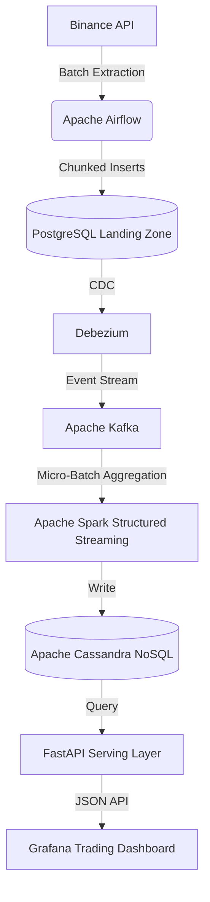

# Lambda Architecture Crypto Data Pipeline: Batch to Real-Time Streaming


## Summary
This project is an enterprise-grade data engineering pipeline designed to bridge the gap between heavy batch extraction and low-latency real-time stream processing. 

It's built to track the cryptocurrency market, the system extracts market depth(Order Books), historical(Candlesticks) and live prices(Tickers) for over 3,700 trading pairs from the Binance API. This architecture uses Change Data Capture (CDC), an event-streaming message broker, and a distributed stream processing engine to ingest, aggregate, and serve over 115,000+ data points to a live trading dashboard with zero data loss.

Thus demonstrating the ability to architect, tune, and deploy a decoupled microservice architecture typically reserved for cloud environments, optimized to run entirely on constrained local hardware.

## System Architecture



## Data Flow Lifecycle

1. **Extraction & Orchestration (Airflow & Pandas):** 
   Airflow DAGs trigger Python scripts that hit Binance REST endpoints. To manage API rate limits across 3,700+ assets, the payload is paginated, flattened, and safely loaded into a PostgreSQL landing zone in chunks.
2. **Change Data Capture (Debezium):** 
   Instead of querying the database for changes, Debezium monitors the PostgreSQL Write-Ahead Log (WAL). Any new market data is instantly captured and broadcasted as an event.
3. **Message Broker (Kafka):** 
   Kafka acts as a buffer by taking in CDC (change data capture) events and separating the heavy data collection from the analytics system.
4. **Stream Processing (PySpark):** 
   Apache Spark Structured Streaming consumes the Kafka topics in 30-second micro-batches. It applies schema casting, flattens nested JSON payloads, and calculates time-windowed aggregations(e.g. 1-minute max spread and volume).
5. **Serving Layer (Cassandra & FastAPI):** 
   Processed metrics are written to Apache Cassandra, chosen for its high-write throughput. A decoupled FastAPI application acts as the serving layer, querying Cassandra and exposing RESTful endpoints (`/candlesticks`, `/order-books`, `/tickers`, `/trading_pairs`).
6. **Visualization (Grafana):** 
   A provisioned Grafana dashboard fetches data from the FastAPI layer, using binary transformations to calculate real-time percentage changes, offloading compute from the database.

### Prerequisites
* Docker & Docker Compose
* Python 3.12+ (managed via `uv` or `pip`)
* Minimum 8GB RAM (12GB+ highly recommended)

### 1. Boot the Distributed Engine 
Due to startup race conditions, this architecture must be booted in a strict 5-stage sequence. 

*(Note: JVM memory limits are hardcoded in `docker-compose.yml` to prevent local hardware CPU/RAM lockups)*

**Step 1: Storage & Coordination**
```bash
docker compose up -d postgres zookeeper cassandra
```
*Wait ~45 seconds for Cassandra to fully initialize*

**Step 2: Messaging & Schema Initialization**
```bash
docker compose up -d kafka schema-registry cassandra-init
```

**Step 3: Change Data Capture (Debezium)**
```bash
docker compose up -d kafka-connect debezium-init
```

**Step 4: Spark Processing Engine**
```bash
docker compose up -d spark-master spark-worker spark-submitter
```

**Step 5: Airflow Orchestration**
```bash
docker compose up -d airflow-init
# Wait for init to complete, then start the rest of the Airflow stack:
docker compose up -d airflow-webserver airflow-scheduler airflow-processor
```

**Step 6: Visualization (Grafana)**
```bash
docker compose up -d grafana
```

### 2. Trigger Pipeline Extraction
Navigate to the Airflow Web UI (`http://localhost:8080`), enable, and trigger the `binance_batch_pipeline` DAG. You can monitor the ingestion chunking via the Airflow worker logs.

### 3. Initialize the API Serving Layer
Install the API requirements and boot the ASGI server:
```bash
uv pip install fastapi uvicorn cassandra-driver
python api.py
```

### 4. Monitor Live Data
Navigate to `http://localhost:3000`. Grafana will bypass manual setup via YAML provisioning and instantly render the live data flowing through the pipeline.

## Engineering Challenges & Solutions

Building a distributed architecture comprising multiple interdependent nodes introduced severe hardware constraints. This project highlights deep system-level optimization:

* **Preventing Linux Swap Thrashing & OOM Kills:** 
  * *Challenge:* Running Spark and Kafka locally caused the Java Virtual Machine(JVM) to hoard host RAM, resulting in catastrophic Out-Of-Memory system freezes.
  * *Solution:* Implemented strict `--driver-memory` and `--executor-memory` caps in the Spark submitter, heavily throttled Kafka's `maxOffsetsPerTrigger`, and reduced default Spark SQL shuffle partitions from 200 to 4. This contained the JVM garbage collection cycle and stabilized the host machine CPU/RAM footprint.
* **Database Transaction Lock Mitigation:** 
  * *Challenge:* Attempting to bulk-insert 1.86 million rows of nested string arrays (Order Books) into PostgreSQL caused the database to lock and enter recovery mode.
  * *Solution:* Re-engineered the Pandas extraction layer to utilize sequential `chunksize` database inserts, discarding memory-heavy `method='multi'` arguments for large payloads to ensure safe, continuous database streaming.
* **Dependency Race Condition Resolution:**
  * *Challenge:* A blanket `docker compose up -d` caused Kafka to crash into an exponential backoff loop because ZooKeeper's JVM had not finished initializing its transaction logs.
  * *Solution:* Enforced a strict, 5-stage sequential boot process, ensuring the storage/coordination layer (ZooKeeper, Postgres) binds to ports before the messaging layer (Kafka) boots, preventing startup network isolation.
